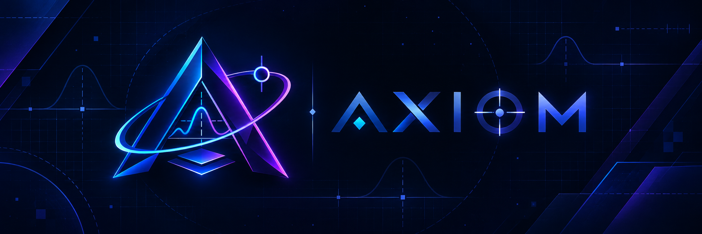

# AXIOM

**Geometry Dash Difficulty Model** · «Сложность, которую можно объяснить».

[English](README.md) · [Что нужно для конечной цели](docs/end-goal-requirements.ru.md) · [Методология](docs/methodology.md) · [Архитектура](docs/architecture.md) · [План развития](docs/roadmap.md)

AXIOM — открытый исследовательский проект для оценки сложности Geometry Dash через измерения движка, человеческое исполнение и освоение. Рейтинговая шкала называется **Axiom Rating (AR)**.

Главный вопрос: с какой вероятностью игрок с заданными навыками пройдёт конкретную версию уровня после заданного объёма подготовки, в заданных технических условиях?

## Что уже работает

Версия 0.1 — автономная лаборатория на Python: анализ исходных строк уровней и реплеев GDR 1 JSON, асимметричных и раздельных временных окон, зависимостей действий, альтернативных маршрутов и коррелированных ошибок. Есть статистика первого прохождения с учётом непроходов, проверки журналов полных прогонов и интерактивные HTML/JSON-отчёты.

В текущей разработке добавлен экспериментальный нативный адаптер для Windows x64, GD 2.2081 и Geode 5.8.2: локальная запись по явному включению, хеши бинарных файлов, callbacks ввода/смерти/финиша, выбранные поля игроков и replay по отсчёту вызовов `processCommands`. Есть команды `axiom native` и `axiom native-compare` для проверки записей и сравнения повторов.

Добавлены [матрица тестовых сценариев](docs/native-fixture-matrix.ru.md) и команды `axiom fixtures`, `axiom fixture-check`, `axiom fixture-response`. Они отделяют созданные уровни и планы ввода от фактических записей, проверяют режимы до анимации финиша, точное совпадение повторов и выбранный отклик на изменение owned-input плана.

Schema 3 нативной записи сохраняет исходные гравитацию, размер, скорость и фактический флаг dual. [Матрица механик](docs/native-mechanics-matrix.ru.md) использует schema 2 спецификации: точные последовательности этих полей и условия механик в обоих сравниваемых samples. Для P2 учитываются только наблюдения с активным dual.

[Первый журнал нативных проверок](docs/native-validation.ru.md) сохраняет неудачное точное сравнение повторов. Последующее [исследование часов](docs/clock-investigation.ru.md) охватило два созданных тестовых уровня и три режима часов — по три replay до финиша на каждую комбинацию. При явно заданном фиксированном шаге Scheduler оба уровня прошли точное сравнение всех проверяемых полей. Обычный режим и фиксация только игрового обновления по-прежнему дают расхождения. Это подтверждает повторяемость записанного набора полей в конкретной экспериментальной среде; сырые записи и игровые бинарные файлы остаются локально.

[Расширенная матрица](docs/native-fixture-matrix.ru.md) прошла **55 отдельных нативных запусков: 11 сценариев и восемь наблюдаемых режимов** при том же фиксированном Scheduler. Все 33 активных replay завершились финишем; три повтора каждого сценария совпали до terminal, и в каждом проверен выбранный отклик на ввод относительно пустого owned-input плана. Два контроля со шипом записали ожидаемую смерть. Проверенная область ограничена объявленными созданными уровнями, планами ввода и записанными полями.

Отдельная [матрица механик](docs/native-mechanics-matrix.ru.md) прошла **56 запусков до финиша в 11 созданных сценариях**: переворот и возврат гравитации, изменение размера, пять наблюдаемых значений скорости, вход и выход из dual. Все 33 replay совпали до terminal по всем 14 компонентам сравнения. Двенадцать контролей подтвердили выбранный отклик на ввод при совпадающих условиях механик в обоих samples, включая отдельные проверки P1 и активного P2 в dual. Это проверенные конструкции при фиксированном Scheduler; общая поддержка этих механик и человеческая сложность ещё не установлены.

[Проверка коллизий и триггеров](docs/native-interactions.ru.md) записала **48 попыток с настоящего начала в 12 конструкциях**: поднятая платформа, склон, потолок, Toggle, Move и цепочка Spawn→Toggle, каждый с парным вариантом. Все 36 owned-replay совпали внутри своих сценариев по 18 записанным компонентам; всего 32 попытки завершились финишем и 16 — объявленной смертью. Все шесть пар прошли проверку; отдельный аудит файлов воспроизвёл сравнения для каждого из трёх повторов. Schema 4 сохраняет флаги контакта, состояния выбранных объектов и парные нативные события. Абсолютные временные метки доставки остаются несовпадающей диагностикой за пределами объявленного сравнения `native-delivery-context-v1`.

Отдельное исследование из **12 синтетических UI-прогонов** подтвердило доставку запланированного пробела через нативную очередь и совпадение выбранной динамики. **Полный поток ввода не совпал ни в одной паре**: UI передавал дополнительное начальное отпускание P1. Все четыре набора UI-повторов совпали по 18 записанным компонентам. Запланированные вызовы `UILayer` обходят Windows и устройство; соответствие обычному вводу ещё не подтверждено.

Последующий **ручной прогон, подтверждённый сообщением оператора**, при нативных часах записал нажатие и отпускание пробела вне обработки команд, затем потребление очереди и успешные вызовы нажатия/отпускания игрока в следующих командах. Сохранены все десять событий, включая начальное отпускание и дополнительную пару, согласующуюся с сообщённым кликом ЛКМ; историческая запись схемы 4 не инструментирует вход мыши. Отдельный аудит файлов прошёл 54 проверки. Это наблюдение доставки клавиатурного ввода; аутентификация устройства и полное соответствие обычному вводу ещё требуют проверки. Предыдущий завершённый прогон не записал клавиатурных callbacks и сохранён отдельно. [Ручная проверка и её границы](docs/native-interactions.ru.md).

Схема **5** собрана и загружена. Новое наблюдение с нативными часами завершилось с **46 клавиатурными входами Space, W, Up, A, D, Left, Right и S, а также пятью парами touch begin/end**. Отдельная группа cube-flat replay совпала по всем 18 компонентам; предыдущая группа не прошла равенство delivery context и сохранена. Эти наблюдения не аутентифицируют устройство и не устанавливают игровой эффект неактивного P2; правая/средняя кнопки мыши и нативное покрытие отмены остаются непроверенными. [Наблюдения ввода, результаты повторов и ручной тест](docs/input-observation.ru.md).

Отдельный [переход к записанному replay](docs/recorded-replay.ru.md) воспроизвёл записанный финиш в **трёх новых replay схемы 6**: все 106 квитанций ввода и выбранная динамика совпали с источником до команды 4894; все 18 компонентов повторов согласованы. Он передаёт записанные аргументы Scheduler и синтетические запросы на входе обработчика очереди. Предшествующий отклонённый export сохранён; эквивалентность ввода UI/ОС и полный критерий M1 остаются неподтверждёнными.

[Наблюдатель ввода Windows](docs/windows-input.ru.md) по явному включению добавляет в схему 7 сообщения Windows и публичные потоки Geode к игровым квитанциям. **Реализация, тесты и нативная сборка готовы; живая квалификация Windows не установлена.** Две стартовые попытки с новым пакетом и отдельный контроль со старым не дали exports; ошибки и записи восстановления четырёх файлов сохранены. Связи клавиш/кнопок схемы 7, аутентификация оборудования и полная эквивалентность ввода не заявляются.

**Это исследовательский прототип; полный критерий M1 ещё не закрыт, человеческая модель ещё не откалибрована.** Совпадение файлов доказывает только согласованность записанного подмножества, происхождение файла само по себе не аутентифицировано. Окна пока передаются извне; примеры полностью синтетические. Реальных рейтингов GRIEF, Slaughterhouse или других уровней пока нет. [Нативный адаптер: запуск и проверки](docs/native-adapter.ru.md).

Отдельная [диагностика нативных вызовов](docs/native-cadence.ru.md) анализирует сохранённые файлы без запуска игры. Архивный источник и три повтора прошли 2496 независимых арифметических проверок: переданные аргументы Scheduler по-прежнему точно совпадают, а входящие аргументы и настенное время различаются. Отношение числа команд ко времени и частота входов отделены от FPS рендера, накладных расходов записи и сложности.

## Запуск в PowerShell

```powershell
git clone https://github.com/TheLitis/AXIOM.git
Set-Location AXIOM
python -m venv .venv
.venv\Scripts\python.exe -m pip install -e .
.venv\Scripts\python.exe -m axiom demo
.venv\Scripts\python.exe -m axiom fixtures examples/native/mechanics-matrix.json
.venv\Scripts\python.exe -m axiom fixtures examples/native/interaction-matrix.json
.venv\Scripts\python.exe -m axiom native-cadence examples/native/synthetic-clock-a.json --json reports/native-cadence.json
.venv\Scripts\python.exe -m axiom native-compare examples/native/synthetic-mechanics-a.json examples/native/synthetic-mechanics-b.json
```

Открыть `reports/demo/index.html`. Установка игры, API-ключи и интернет для анализа не требуются. Для повторяемой среды разработки: `uv sync --locked --extra dev`, затем `uv run --locked axiom demo`.

## Смысл AR

`AR = 1000 + 100 × log₂(T50 / T50 опорного испытания)`

T50 — активное время подготовки, к которому вероятность первого прохождения достигает 50% для зафиксированных группы игроков, исходных навыков и протокола. +100 AR означает удвоение этого времени; +200 — увеличение в четыре раза. Это предложенное устройство шкалы, а не уже подтверждённые оценки существующих уровней.

Непройденный после 40 часов уровень даёт цензурированное наблюдение, а не «время прохождения 40 часов». Если данных для T50 недостаточно, число AR отсутствует. Интервал погрешности симуляции не выдаётся за неопределённость человеческого рейтинга.

## Дальнейшее развитие

Следующий этап — разобраться с обнаруженным расхождением доставки ввода и проверить всю цепочку Windows → игра, фокус окна, перезапуск и прерывания. Нужно расширить охват за пределы проверенных коллизий и триггеров, измерить полноту условий, накладные расходы записи и скорость нативных прогонов. После определения поддерживаемой области replay — измерение совместных окон, эксперименты с согласившимися игроками, прогнозы освоения и проверка на новых игроках и уровнях.

В [реестре факторов](docs/factors.csv) 64 измеряемых направления. Пока это предложения для исследования, без произвольно назначенных весов. [План](docs/roadmap.md) содержит отдельные критерии готовности каждого этапа. Код, документация и тесты открыты под MIT; проект не связан с RobTop Games.
