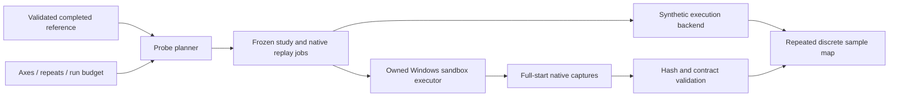

# Command-grid measurement pipeline

[Русская версия](probe-engineering.ru.md) · [Architecture](architecture.md) · [Roadmap](roadmap.md)

AXIOM now has the engineering foundation for M2: a bounded joint probe planner, an execution interface, canonical native replay exchange, an automatic Windows sandbox executor, native capture ingestion and a discrete result map. This is implemented software. Qualified native measurement and physical timing-window acceptance remain separate work.

## Pipeline and boundaries



| Module | Implemented responsibility |
|---|---|
| `axiom.probeplan` | Freeze source identity; enumerate 1–3 joint axes; preserve event order; schedule baseline repeats first; bound expansion |
| `axiom.proberun` | Materialize exact study bytes and canonical replay files; sequential synthetic backend protocol; atomic fresh outputs |
| `axiom.probejobs` | Reconstruct exact job order, validate canonical replay bytes, refuse unexpected exchange files and recheck byte inventories |
| `axiom.nativeprobe` | Sequential capture-producing backend, frozen input snapshot, per-attempt checkpoints and explicit cancellation/errors; [native worker contract](native-probe-executor.md) |
| `axiom.probeadapter` | Import hash-bound native capture references with exact build/environment/plan identity and full-start terminal requirements |
| `axiom.probes` | Preserve missing/error/inconsistent outcomes; assemble discrete accepted components, zero-axis slices and coupling counterexamples |

The planner accepts a completed, full-start schema-4/5 `owned-pre-command` replay under `fixed-scheduler-240`. Its source may be explicitly synthetic or a supplied native capture; neither becomes independently verified through file validation. The baseline must consume its entire declared input plan. Configuration and state completeness remain exactly as recorded.

This initial measurement clock is **`processCommands_call_index`**. Offsets are integer command calls, not milliseconds, hardware arrival times, certified physics ticks or frame counts. Fixed Scheduler 240 does not make each processCommands call 1/240 second.

## Freeze a study and export jobs

The public reference is fully generated synthetic data. The two-axis example changes the first press and release of a four-event plan:

```json
{
  "schema_version": 1,
  "kind": "native_probe_spec",
  "id": "synthetic-coupled-command-grid",
  "axes": [
    {"event_index": 0, "offsets_commands": [-2, -1, 0, 1, 2]},
    {"event_index": 1, "offsets_commands": [-2, -1, 0, 1, 2]}
  ],
  "repetitions": 3,
  "run_budget": 75
}
```

```powershell
uv sync --locked --extra dev
uv run --locked axiom probe-plan examples/probes/synthetic-reference.json examples/probes/coupled-grid.json --json reports/probe-study.json
uv run --locked axiom probe-export reports/probe-study.json --output reports/probe-exchange
uv run --locked axiom probe-demo --out reports/probe-demo
uv run --locked axiom probe-map reports/probe-demo/study.json reports/probe-demo/results.json --json reports/probe-map.json
```

Output paths must be fresh and their ordinary parent directory must exist. No command above launches Geometry Dash, creates OS input or uploads data. `probe-export` copies the original study bytes to `study.json`, creates `plans/pNNNN.json` and publishes `jobs.json` last. Without `jobs.json`, a partially written exchange is not ready for execution. JSON publication uses atomic no-replacement file creation; symlink/reparse ancestors and existing destinations are refused.

The study uses schema 1, kind `native_probe_study` and protocol `full-start-owned-command-grid-v1`. Its canonical SHA-256 is distinct from the raw study-file SHA-256. Native replay files use the existing schema-1 `native_replay` contract, sorted compact UTF-8 JSON followed by one LF. The replay-file SHA-256 names those exact bytes; pretty-printing a replay changes its identity. Every job names its point, repetition, replay path/hash, clock policy, driver and full-start requirement.

Each axis has a unique source event index and strictly increasing integer offsets including zero. Repetitions range from 2 to 8. The planner permits at most 4096 grid points and 4096 requested trials, and bounds grid/input expansion before enumeration. The requested budget includes points later found invalid. A shifted index outside the native recorder bound or a reversal of source event order becomes `invalid_schedule`, not an engine death. Tied events retain source order. Remaining events, players and buttons stay in the plan.

## Execution interface

`ProbeBackend.run(trial, replay_plan)` receives independent argument copies. The current in-process implementation admits **synthetic backends only**. It executes each scheduled job once, without implicit retries or resume, and retains exceptions, declared deadline failures, malformed replies and reused witness IDs as `runner_error`. A synchronous callback must implement its own deadline; the interface cannot cancel arbitrary Python code.

Synthetic results use kind `probe_backend_results` with separate `synthetic-full-run-terminal` witnesses. They are never fabricated native captures. The demo accepts precisely the coordinates `(-2,-2)`, `(0,0)` and `(2,2)` on the declared 5×5 grid. It produces 75 synthetic trial records, 3 accepted samples, 22 death samples and 6 observed counterexamples to multiplying accepted marginal projections. The all-zero control is repeated first. Witness IDs identify separate executions; sampled outcomes and schedules are reproducible, while new execution IDs differ between runs.

## Automatic native execution and capture import

`axiom probe-run` consumes `jobs.json` and the native replay files through the [automatic Windows executor](native-probe-executor.md). It requires a real reference declaring native origin, starts each job from the beginning in a new runtime, checks frozen build/environment/clock/driver identity, preserves captures and checkpoints, and owns the game deadline and cleanup. The shared isolated profile is leased exclusively and four experiment files are restored independently. This is implemented execution software; this increment performed no live GD campaign or physical-window qualification. Engine checkpoint restoration remains unimplemented.

Supply a separate schema-1 `native_probe_results` manifest:

```json
{
  "schema_version": 1,
  "kind": "native_probe_results",
  "study_sha256": "<canonical study SHA-256>",
  "attempts": [
    {"trial_id": "p0012-r1", "capture_path": "captures/run-1.json", "capture_sha256": "<raw capture SHA-256>"},
    {"trial_id": "p0012-r2", "error": "executor deadline reached"}
  ]
}
```

Capture paths are confined relative to the results manifest, with ordinary files/ancestors only. Duplicate/unknown trial IDs, reused capture files/hashes and reused native attempt IDs cannot supply independent repetitions. Identity or capture validation failures remain `rejected` observations. Explicit executor errors remain `runner_error`; omitted jobs remain missing. None is converted to a death.

Imported captures must match the exact challenge, environment, collector, recorded field lists, planned inputs and canonical exported replay-file hash. A completed trial must consume the whole plan; a death may retain a valid executed prefix and unexecuted tail. The native terminal event retains its existing collector contract. Reported native origin is preserved alongside `not_authenticated`; data imported from a synthetic capture remains synthetic.

## Map semantics

A point becomes `accepted_sample` or `death_sample` only after all requested repetitions agree. Missing repetitions produce `incomplete`; executor or capture failures produce `unknown`; conflicting outcomes or differing native terminal state/event/command produce `inconsistent_repeats`. Native repetition comparison here covers those terminal fields, not complete trajectory determinism or the full M1 gate.

Accepted graph vertices connect only when one axis differs by exactly one command call. Unobserved sites are not bridged. Components describe the **sampled graph**, not a proof of continuous disconnected physical windows. Axis slices hold other offsets at zero; accepted marginal projections are not multiplied into a feasible set. Tested death points inside their Cartesian product are retained as coupling counterexamples.

The first synthetic pipeline increment passed **1139 tests and 83 subtests**, including 259 planner/executor/import/map checks; these are historical counts for that increment. Current executor checks and their commands are listed in the [native executor document](native-probe-executor.md#software-checks-and-remaining-qualification). The 75-record demo exercises declared synthetic truth and performs no native execution.

The map records whether the baseline control was established and whether the declared grid is complete. Even a complete grid has no interpolation, hardware-timing claim, checkpoint composition, impossibility proof, human probability or AR. M1 and M2 scientific acceptance gates remain open. The next measurement work is qualifying the automatic executor on native trials, broader perturbations and delayed-failure/alternative-route tests.
