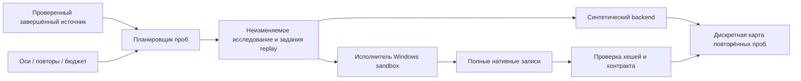

# Конвейер измерений на сетке команд

[English version](probe-engineering.md) · [Архитектура](architecture.md) · [Roadmap](roadmap.md)

В AXIOM реализована инженерная основа M2: ограниченный планировщик совместных проб, интерфейс исполнения, обмен каноническими нативными replay, автоматический исполнитель Windows sandbox, импорт записей и дискретная карта результатов. Это работающий код. Подтверждённые нативные измерения и принятие физических окон остаются отдельной работой.

## Конвейер и границы



| Модуль | Реализованная задача |
|---|---|
| `axiom.probeplan` | Фиксация источника; совместная сетка 1–3 осей; порядок событий; повторы baseline первыми; ограничение расширения |
| `axiom.proberun` | Точные байты study и канонические replay; протокол последовательного синтетического backend; атомарные новые файлы |
| `axiom.probejobs` | Восстановление точного порядка заданий, канонические байты replay, отклонение лишних файлов и повторная проверка инвентарей |
| `axiom.nativeprobe` | Последовательный backend записей, снимок входных файлов, checkpoints попыток и явные отмена/ошибки; [контракт native worker](native-probe-executor.ru.md) |
| `axiom.probeadapter` | Импорт ссылок на нативные записи с хешами, точной идентичностью сборки/среды/плана и полным стартом |
| `axiom.probes` | Сохранение пропусков/ошибок/несогласованных повторов; компоненты дискретных принятых точек, срезы и примеры зависимости действий |

Планировщик принимает завершённый replay схемы 4/5 с полным стартом, `owned-pre-command` и `fixed-scheduler-240`. Источник может быть явно синтетическим или предоставленной нативной записью; проверка файла не делает его независимо подтверждённым. Baseline должен исполнить весь заявленный план. Полнота конфигурации и состояния остаётся ровно такой, как записана.

Начальные часы измерения — **`processCommands_call_index`**. Смещения измеряются целыми вызовами команд, а не миллисекундами, приходом аппаратного ввода, подтверждёнными тиками физики или кадрами. Fixed Scheduler 240 не превращает каждый вызов processCommands в 1/240 секунды.

## Зафиксировать исследование и экспортировать задания

Публичный источник полностью сгенерирован и синтетический. Пример с двумя осями меняет первое нажатие и отпускание в плане из четырёх событий:

```json
{
  "schema_version": 1,
  "kind": "native_probe_spec",
  "id": "synthetic-coupled-command-grid",
  "axes": [
    {"event_index": 0, "offsets_commands": [-2, -1, 0, 1, 2]},
    {"event_index": 1, "offsets_commands": [-2, -1, 0, 1, 2]}
  ],
  "repetitions": 3,
  "run_budget": 75
}
```

```powershell
uv sync --locked --extra dev
uv run --locked axiom probe-plan examples/probes/synthetic-reference.json examples/probes/coupled-grid.json --json reports/probe-study.json
uv run --locked axiom probe-export reports/probe-study.json --output reports/probe-exchange
uv run --locked axiom probe-demo --out reports/probe-demo
uv run --locked axiom probe-map reports/probe-demo/study.json reports/probe-demo/results.json --json reports/probe-map.json
```

Выходные пути должны быть новыми, их обычный родительский каталог — существовать. Эти команды не запускают Geometry Dash, не создают ввод ОС и не отправляют данные. `probe-export` копирует исходные байты study в `study.json`, создаёт `plans/pNNNN.json` и последним публикует `jobs.json`. Без `jobs.json` частично записанный пакет не готов к исполнению. JSON публикуется атомарным созданием без замены; symlink/reparse предки и существующие выходные пути отклоняются.

Study использует схему 1, kind `native_probe_study` и протокол `full-start-owned-command-grid-v1`. Канонический SHA-256 отличается от хеша исходного файла study. Нативные replay используют прежний контракт схемы 1 `native_replay`: компактный UTF-8 JSON с сортированными ключами и одним LF в конце. SHA-256 replay относится к этим точным байтам; переформатирование меняет идентичность. Каждое задание содержит точку, номер повтора, путь/хеш replay, политику часов, driver и требование полного старта.

Каждая ось содержит уникальный индекс исходного события и строго возрастающие целые смещения с нулём. Повторов — от 2 до 8. Допускаются до 4096 точек сетки и 4096 запрошенных прогонов; расширение сетки/ввода ограничивается до перечисления. Бюджет включает точки, позднее признанные недопустимыми. Выход индекса за пределы нативного recorder или изменение исходного порядка дают `invalid_schedule`, а не смерть движка. Совпадающие индексы сохраняют порядок источника. Остальные события, игроки и кнопки остаются в плане.

## Интерфейс исполнения

`ProbeBackend.run(trial, replay_plan)` получает отдельные копии аргументов. Текущая реализация внутри Python допускает **только синтетические backend**. Каждое запланированное задание вызывается один раз, без неявных повторных попыток и resume; исключения, заявленные ошибки срока, некорректные ответы и повторные witness IDs сохраняются как `runner_error`. Синхронный callback должен реализовать собственное ограничение времени; интерфейс не умеет отменять произвольный Python-код.

Синтетические результаты имеют kind `probe_backend_results` и отдельные свидетели `synthetic-full-run-terminal`. Они не превращаются в выдуманные нативные записи. Demo принимает ровно координаты `(-2,-2)`, `(0,0)` и `(2,2)` на заявленной сетке 5×5. Получаются 75 синтетических записей прогонов, 3 принятые точки, 22 точки смерти и 6 наблюдаемых контрпримеров к перемножению принятых маргинальных проекций. Нулевой контроль повторяется первым. Witness IDs различают исполнения; исходы и расписания воспроизводимы, новые идентификаторы исполнения между запусками отличаются.

## Автоматическое нативное исполнение и импорт

`axiom probe-run` потребляет `jobs.json` и нативные replay через [автоматический исполнитель Windows](native-probe-executor.ru.md). Ему нужен настоящий источник с заявленным нативным происхождением; каждое задание стартует с начала в новом runtime, проверяются зафиксированные сборка/среда/часы/driver, сохраняются записи и checkpoints, контролируются игровой deadline и очистка. Общий изолированный профиль защищён исключительной lease; четыре экспериментальных файла восстанавливаются независимо. Это реализованное программное исполнение; в данном изменении живой кампании GD и подтверждения физических окон не было. Восстановление состояния движка из checkpoint ещё не реализовано.

Результаты передаются отдельным manifest схемы 1 `native_probe_results`:

```json
{
  "schema_version": 1,
  "kind": "native_probe_results",
  "study_sha256": "<canonical study SHA-256>",
  "attempts": [
    {"trial_id": "p0012-r1", "capture_path": "captures/run-1.json", "capture_sha256": "<raw capture SHA-256>"},
    {"trial_id": "p0012-r2", "error": "executor deadline reached"}
  ]
}
```

Пути записей ограничены относительно manifest результатов, разрешены только обычные файлы и предки. Дубли/неизвестные trial IDs, повторное использование файла/хеша записи и нативного attempt ID не могут подменить независимые повторы. Ошибки идентичности или проверки записи остаются наблюдениями `rejected`. Явные ошибки исполнителя остаются `runner_error`; отсутствующие задания — пропусками. Ни одно не превращается в смерть.

Импортированные записи должны точно совпасть по challenge, среде, collector, спискам записанных полей, planned inputs и хешу канонического экспортированного replay. Завершённая попытка должна исполнить весь план; смерть может сохранять валидный исполненный prefix и неисполненный хвост. Нативное terminal event сохраняет прежний контракт collector. Заявленное происхождение остаётся рядом с `not_authenticated`; данные из синтетической записи остаются синтетическими.

## Смысл карты

Точка становится `accepted_sample` или `death_sample` только после согласования всех запрошенных повторов. Пропуски дают `incomplete`; ошибки исполнителя или записей — `unknown`; разные исходы либо нативные terminal state/event/command — `inconsistent_repeats`. Сравнение нативных повторов здесь охватывает эти терминальные поля, а не детерминизм полной траектории или весь M1.

Вершины графа принятых точек соединяются, только если одна ось отличается ровно на один вызов команды. Непроверенные места не соединяются. Компоненты описывают **выборочный граф**, а не доказывают непрерывные разорванные физические окна. Срезы удерживают остальные смещения в нуле; принятые маргинальные проекции не перемножаются в допустимое множество. Проверенные точки смерти внутри их декартова произведения сохраняются как контрпримеры независимости.

Первое синтетическое изменение конвейера прошло **1139 тестов и 83 subtests**, включая 259 проверок планировщика/исполнителя/импорта/карты; это исторические числа для того изменения. Текущие проверки исполнителя и команды находятся в [документе нативного исполнителя](native-probe-executor.ru.md#программные-проверки-и-оставшаяся-квалификация). Demo из 75 записей проверяет объявленную синтетическую истину и не выполняет нативный прогон.

Карта указывает, установлен ли baseline и полна ли заявленная сетка. Даже полная сетка не даёт интерполяции, аппаратного тайминга, композиции checkpoint, доказательства невозможности, человеческой вероятности или AR. Научные критерии M1 и M2 остаются открытыми. Следующая измерительная работа — квалификация автоматического исполнителя на нативных прогонах, расширение сдвигов, проверки отложенной смерти и альтернативных маршрутов.
